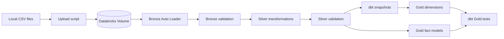
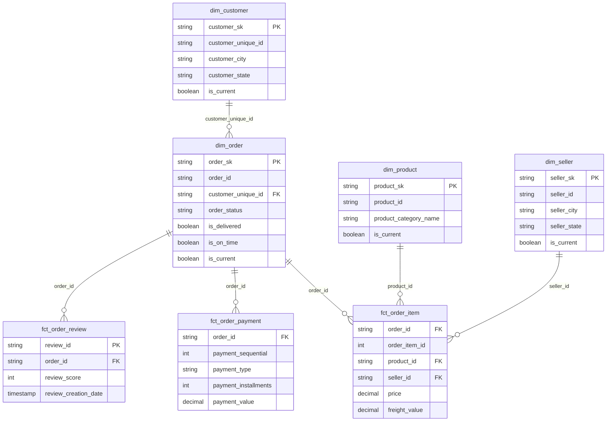

# 🛒 Olist — End-to-End E-commerce Data Pipeline

> A production-style data engineering pipeline that ingests Brazilian Olist e-commerce data into Databricks, applies Bronze/Silver/Gold transformations, and produces an analytics-ready dimensional model with Delta Lake and dbt.

---

## 📌 Table of Contents

- [Overview](#-overview)
- [Architecture](#️-architecture)
- [Tech Stack](#️-tech-stack)
- [Pipeline Walkthrough](#-pipeline-walkthrough)
  - [1. Source & Upload](#1-source--upload)
  - [2. Bronze Layer — Raw Ingestion](#2-bronze-layer--raw-ingestion)
  - [3. Silver Layer — Cleansing & Enrichment](#3-silver-layer--cleansing--enrichment)
  - [4. Gold Layer — Dimensional Modeling](#4-gold-layer--dimensional-modeling)
- [Infrastructure & Security](#-infrastructure--security)
- [Project Structure](#-project-structure)
- [Key Outcomes](#-key-outcomes)

---

## 🗺 Overview

This project implements an end-to-end lakehouse pipeline for the public Brazilian Olist e-commerce dataset. It covers ingestion, schema validation, incremental processing, cleansing, deduplication, historical tracking, and analytical modeling.

**What makes this pipeline production-oriented:**

- **Medallion Architecture** — raw, trusted, and analytical data are isolated into Bronze, Silver, and Gold layers.
- **Metadata-driven schemas** — Bronze and Silver table contracts are maintained in YAML files under `schema/`.
- **Incremental and restartable** — Databricks Auto Loader uses checkpoint locations to track processed source files.
- **Dependency-aware orchestration** — Databricks Asset Bundles run validation before dependent Silver and Gold tasks.
- **SCD Type 2 history** — dbt snapshots preserve historical changes for key customer and order entities.
- **Lakehouse governance** — Unity Catalog separates resources into `bronze`, `silver`, `gold`, `staging`, and supporting volumes.

**Source datasets:** CSV files covering orders, customers, order items, payments, reviews, products, sellers, geolocation, and product-category translations.

---

## 🏗️ Architecture



The pipeline follows an ELT pattern:

1. CSV files are uploaded to a Unity Catalog staging volume.
2. Databricks Auto Loader lands data into append-only Bronze Delta tables.
3. PySpark tasks cleanse and MERGE trusted records into Silver Delta tables.
4. dbt snapshots create Type 2 dimensions, while incremental dbt models publish fact tables.
5. Generic and custom dbt tests validate key relationships and aggregation invariants.

**Layer responsibilities:**

| Layer | Storage | Responsibility |
| --- | --- | --- |
| Bronze | `olist_project.bronze` | Preserve source records, file lineage, and ingestion timestamps |
| Silver | `olist_project.silver` | Clean, deduplicate, enrich, normalize, and join source entities |
| Gold | `olist_project.gold` | Deliver a star-schema model for reporting and analytics |
| Staging | `olist_project.staging` | Store source files and Auto Loader checkpoint data |

---

## ⚙️ Tech Stack

| Layer | Technology | Purpose |
| --- | --- | --- |
| Orchestration | Databricks Asset Bundles | Dependency-aware pipeline deployment and task scheduling |
| Storage | Unity Catalog + Databricks Volumes | Governed catalog objects and source/checkpoint storage |
| Compute | Databricks Runtime + Apache Spark | Distributed PySpark ingestion and transformation |
| Table Format | Delta Lake | ACID transactions, incremental MERGE, and schema support |
| Raw Ingestion | Databricks Auto Loader | Incremental file discovery and schema-controlled CSV ingestion |
| Validation | Pandera + PySpark | Bronze and Silver data-quality checks |
| Modeling | dbt + dbt-databricks | Dimensional models, snapshots, and data-quality tests |
| Source Files | CSV | Olist e-commerce relational datasets |
| Configuration | Python, YAML, SQL | Environment variables, schema contracts, and setup resources |

---

## 🔄 Pipeline Walkthrough

### 1. Source & Upload

The raw data is stored in `data/` and includes nine datasets:

| Dataset | Target area |
| --- | --- |
| `order.csv` | Orders |
| `customer.csv` | Customers |
| `order_item.csv` | Order line items |
| `order_payment.csv` | Payment records |
| `order_review.csv` | Customer reviews |
| `product.csv` | Product catalog |
| `seller.csv` | Seller catalog |
| `geolocation.csv` | Customer/seller geolocation reference |
| `product_category_name_translation.csv` | Portuguese-to-English category mapping |

`script/upload.py` uploads each CSV to a Unity Catalog Volume folder based on dataset type:

````text
/Volumes/olist_project/staging/lakehouse/
├── order/
├── customer/
├── order_item/
├── order_payment/
├── order_review/
├── product/
├── seller/
└── static/
````

### 2. Bronze Layer — Raw Ingestion

The Bronze layer reads files from the landing Volume with Databricks Auto Loader and writes append-only Delta tables. It also records:

- `_source_file` — source file lineage
- `_ingest_timestamp` — when the record was ingested

```text
Bronze table naming
├── bronze.order_raw
├── bronze.customer_raw
├── bronze.order_item_raw
├── bronze.order_payment_raw
├── bronze.order_review_raw
├── bronze.product_raw
├── bronze.seller_raw
├── bronze.geolocation_raw
└── bronze.product_category_name_translation_raw
```

Bronze schemas are controlled by YAML files in `schema/bronze/`. Static datasets use a dedicated batch ingestion task, while incremental datasets use the Auto Loader task and a matching Volume checkpoint under `staging.checkpoints`.

After each Bronze task, a dedicated Pandera/PySpark test validates its table before any Silver task begins.

### 3. Silver Layer — Cleansing & Enrichment

The Silver layer transforms Bronze records and publishes trusted Delta tables with Delta `MERGE` operations.

**Key transformations:**

- **Geolocation deduplication** — consolidates repeated ZIP-code coordinates.
- **Customer enrichment** — joins customer records to cleaned geolocation data.
- **Product enrichment** — translates Portuguese category names to English.
- **Seller cleansing** — standardizes seller location attributes.
- **Order normalization** — cleans order lifecycle timestamps and status values.
- **Fact entity cleansing** — validates and normalizes order items, payments, and reviews.

```text
Silver tables
├── silver.geolocation
├── silver.customer
├── silver.product
├── silver.seller
├── silver.order
├── silver.order_item
├── silver.order_payment
└── silver.order_review
```

Each Silver merge has a dedicated test task. Failure of a validation task blocks downstream work through the Databricks job dependency graph.

### 4. Gold Layer — Dimensional Modeling

The Gold layer uses dbt snapshots and models to publish a star schema in `olist_project.gold`.



**Gold dimensions:**

| Table | Modeling Pattern | Purpose |
| --- | --- | --- |
| `dim_customer` | dbt snapshot / SCD Type 2 | Track customer attribute history |
| `dim_order` | dbt snapshot / SCD Type 2 | Track order lifecycle and delivery changes |
| `dim_product` | dbt snapshot / SCD Type 2 | Track product catalog history |
| `dim_seller` | dbt snapshot / SCD Type 2 | Track seller attribute history |

**Gold facts:**

| Table | Grain | Measures |
| --- | --- | --- |
| `fct_order_item` | One row per order line item | Price and freight value |
| `fct_order_payment` | One row per payment record | Installments and payment value |
| `fct_order_review` | One row per review | Review score and timestamps |

Gold validation combines dbt schema tests with custom SQL tests for row counts and aggregation invariants.

---

## 🔐 Infrastructure & Security

### Unity Catalog Layout

```text
olist_project/
├── staging/
│   ├── lakehouse/       # Source CSV files
│   └── checkpoints/     # Auto Loader and merge checkpoints
├── bronze/              # Immutable-style raw ingestion tables
├── silver/              # Cleaned and enriched tables
├── gold/                # Dimensions and facts
└── dbt staging models    # dbt views against Silver sources
```

### Deployment Resources

- `databricks.yml` defines bundle variables and the `olist_pipeline_job` workflow.
- `script/setup.sql` creates the catalog, schemas, Volumes, and account-level grants.
- `.env` supplies catalog and volume configuration used by local and notebook code.
- Databricks job environments pin dbt and Pandera dependencies.

### Security Principles

- Unity Catalog is the primary access-control boundary.
- Source and checkpoint data is stored in governed Volumes rather than unmanaged paths.
- Databricks authentication is inherited through SDK profiles or workspace credentials.
- Access to source and checkpoint locations should be granted using Unity Catalog privileges rather than embedded secrets.

---

## 📁 Project Structure

```text
Olist_Data_Pipeline/
├── databricks.yml          # Databricks Asset Bundle and pipeline orchestration
├── README.md
├── data/                   # Source CSV files
├── schema/
│   ├── registry.yaml       # Schema registry metadata
│   ├── bronze/            # Bronze table contracts
│   └── silver/            # Silver table contracts
├── script/
│   ├── setup.sql          # Unity Catalog resources and grants
│   └── upload.py          # Uploads source CSV files to the landing Volume
├── task/
│   ├── bronze/            # Bronze ingestion tasks
│   └── silver/            # Silver cleaning and MERGE tasks
├── test/
│   ├── bronze/            # Bronze validation notebooks
│   └── silver/            # Silver validation notebooks
└── dbt_gold/
    ├── dbt_project.yml
    ├── models/
    │   ├── staging/       # Silver source registrations
    │   └── gold/          # Dimension and fact models
    ├── snapshots/         # SCD Type 2 snapshots
    └── tests/             # Custom dbt SQL tests
```

---

## 🚀 Setup & Deployment

### Prerequisites

- Databricks workspace with Unity Catalog enabled
- Databricks CLI and Databricks Asset Bundles
- SQL Warehouse for dbt tasks
- Python 3
- `databricks-sdk` and `python-dotenv`
- `dbt-core`, `dbt-databricks`, and `pandera[pyspark]`

### 1. Create Unity Catalog resources

Run `script/setup.sql` in a Databricks SQL editor:

```sql
CREATE CATALOG IF NOT EXISTS olist_project;
CREATE SCHEMA IF NOT EXISTS olist_project.bronze;
CREATE SCHEMA IF NOT EXISTS olist_project.silver;
CREATE SCHEMA IF NOT EXISTS olist_project.gold;
CREATE SCHEMA IF NOT EXISTS olist_project.staging;
CREATE VOLUME IF NOT EXISTS olist_project.staging.lakehouse;
CREATE VOLUME IF NOT EXISTS olist_project.staging.checkpoints;
```

### 2. Configure local environment

Create a `.env` file in the project root:

```dotenv
DATA_FOLDER=data
CATALOG=olist_project
STAGING_SCHEMA=staging
LANDING_VOLUME=lakehouse
DATABRICKS_CONFIG_PROFILE=your-profile
```

Upload the source files:

```bash
python script/upload.py
```

### 3. Validate and deploy

```bash
databricks bundle validate
databricks bundle deploy
databricks bundle run olist_pipeline_job
```

The job executes Bronze ingestion and tests first, Silver transformations and tests second, then dbt snapshots and Gold models.

### 4. Develop with dbt

```bash
cd dbt_gold
dbt deps
dbt snapshot
dbt run
dbt test
```

Run focused development commands:

```bash
dbt snapshot --select snapshot_customer
dbt run --select dim_customer
dbt test --select dim_customer
```

---

## 🧪 Testing

Data quality is enforced at multiple stages:

- **Bronze tests** validate source table schemas and required data quality conditions.
- **Silver tests** validate cleaned entities and relationships after transformation.
- **dbt generic tests** validate uniqueness, nullability, and referential rules.
- **Custom dbt tests** verify row-count and aggregation invariants.

The job dependency graph prevents downstream processing when an upstream validation task fails.

---

## 🎯 Key Outcomes

- Implemented a complete Bronze → Silver → Gold lakehouse pipeline.
- Used Databricks Auto Loader and Delta Lake for incremental, transactional ingestion.
- Added schema contracts and multiple data-quality gates.
- Used dbt snapshots to implement SCD Type 2 dimensions.
- Built a governed dimensional model for order, customer, product, seller, payment, item, and review analytics.
- Automated deployment and task dependencies with a Databricks Asset Bundle.

**Data engineering principles applied:**

- **Separation of concerns** — ingestion, transformation, modeling, and validation are separate tasks.
- **Idempotency** — checkpointing and MERGE/snapshot patterns support reruns.
- **Data lineage** — source file and ingest metadata are preserved in the Bronze layer.
- **Fail-fast processing** — downstream tasks depend on successful validation results.

---

Built with `Databricks`, `Apache Spark`, `Delta Lake`, `Unity Catalog`, and `dbt`.