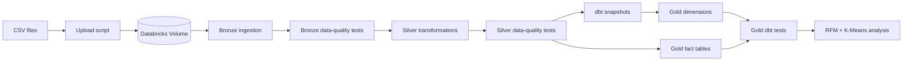
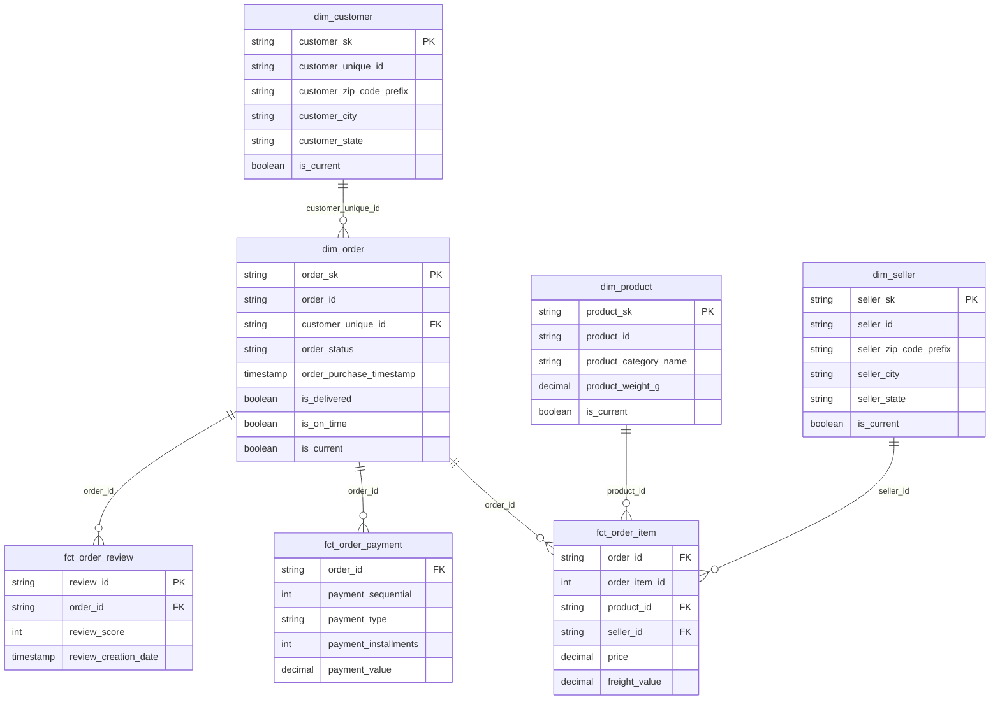

# Olist Data Pipeline

An end-to-end e-commerce data pipeline built with Databricks, Apache Spark, Delta Lake, dbt, and Unity Catalog. The project ingests the Brazilian Olist dataset, validates and cleans it, then produces an analytics-ready dimensional model in the Gold layer.

## Architecture



### Medallion layers

- **Bronze**: lands raw CSV records in `olist_project.bronze` using Databricks Auto Loader. The raw-table schemas are controlled by the YAML schema registry in `schema/`.
- **Silver**: cleans, deduplicates, enriches, and merges records into `olist_project.silver` tables. This includes geolocation deduplication, customer location enrichment, product-category translation, and order status normalization.
- **Gold**: uses dbt and Delta tables to create a dimensional star schema in `olist_project.gold`, including SCD Type 2 dimensions and fact tables.

## Dataset and data model

The source data is under `data/` and contains orders, customers, order items, payments, reviews, products, sellers, geolocation, and translated product categories.

Gold tables:

- `dim_customer` — customer attributes with SCD Type 2 history
- `dim_order` — order lifecycle and delivery metrics with SCD Type 2 history
- `dim_product` — product catalog with SCD Type 2 history
- `dim_seller` — seller attributes with SCD Type 2 history
- `fct_order_item` — order line items, prices, and freight
- `fct_order_payment` — payment installments and values
- `fct_order_review` — customer review scores and comments

### Gold star-schema



## Key implementation

- Databricks Asset Bundle orchestration with dependencies between Bronze, Silver, Gold, and validation tasks
- Unity Catalog for the `olist_project` catalog and separate `bronze`, `silver`, `gold`, and `staging` schemas
- Pandera schema validation and YAML-based schema definitions
- Databricks Auto Loader for incremental CSV ingestion
- Delta Lake MERGE operations for Silver tables
- dbt incremental models and snapshots
- SCD Type 2 tracking for customer, order, product, and seller dimensions
- Bronze, Silver, and dbt Gold data-quality tests
- RFM (Recency, Frequency, Monetary) analysis and K-Means customer segmentation

## Project structure

```text
Olist_Data_Pipeline/
├── databricks.yml          # Asset Bundle and pipeline orchestration
├── data/                   # Source CSV files
├── notebook/               # Customer segmentation notebook
├── schema/                 # Bronze/Silver schema registry and YAML definitions
├── script/
│   ├── setup.sql           # Catalog, schemas, volume, and grants setup
│   └── upload.py           # Upload source files to the Databricks Volume
├── task/
│   ├── bronze/             # Bronze ingestion Spark tasks
│   └── silver/             # Silver cleaning and merge tasks
├── test/
│   ├── bronze/             # Bronze data-quality tests
│   └── silver/             # Silver data-quality tests
└── dbt_gold/
    ├── models/gold/        # Dimension and fact models
    ├── snapshots/          # SCD Type 2 dbt snapshots
    └── tests/              # Custom dbt tests
```

## Prerequisites

- Databricks workspace with Unity Catalog enabled
- Databricks CLI and Databricks Asset Bundles
- SQL Warehouse for dbt
- Python 3
- `databricks-sdk` and `python-dotenv` for the upload script
- Packages used by the Databricks environment: `dbt-core`, `dbt-databricks`, `python-dotenv`, and `pandera[pyspark]`

## Setup

1. Create Unity Catalog resources:

```sql
USE CATALOG olist_project;
```

Run `script/setup.sql` in a Databricks SQL editor. It creates the catalog, schemas, and landing/checkpoint volumes and grants account users access.

2. Configure your local Databricks credentials:

```dotenv
# .env
DATA_FOLDER=data
CATALOG=olist_project
STAGING_SCHEMA=staging
LANDING_VOLUME=lakehouse
```

The upload script uses Databricks CLI SDK authentication and the `DATABRICKS_CONFIG_PROFILE` or environment variables supported by the SDK.

3. Upload the source CSV files:

```bash
python script/upload.py
```

The files are mapped to folders under `/Volumes/olist_project/staging/lakehouse/` by dataset type.

## Deploy and run

Validate and deploy the Databricks Asset Bundle:

```bash
databricks bundle validate
databricks bundle deploy
databricks bundle run olist_pipeline_job
```

The job runs Bronze ingestion and tests first, then Silver transformations and tests, followed by dbt snapshots, Gold dimensions, fact tables, and model tests.

## dbt development

The dbt project is located in `dbt_gold/`. Example commands:

```bash
cd dbt_gold
dbt deps
dbt snapshot
dbt run
dbt test
```

Run a focused model or test when developing:

```bash
dbt snapshot --select snapshot_customer
dbt run --select dim_customer
dbt test --select dim_customer
```

## Customer segmentation

`notebook/customer_segmentation.ipynb` connects to Databricks through the SQL connector, reads delivered orders and payment values from the Gold tables, and performs:

- RFM feature calculation
- Feature scaling
- K-Means clustering
- Silhouette analysis
- Cluster visualization and segment interpretation

Configure the Databricks host and personal access token in `~/.databrickscfg` before running the notebook.

## Testing

Data-quality validation is implemented at multiple stages:

- Pandera or Spark-based tests for Bronze ingested tables
- Silver tests for cleaned and enriched data
- dbt generic tests such as uniqueness and null checks
- Custom dbt tests for aggregation invariants in `dbt_gold/tests/`

The pipeline intentionally stops downstream processing if a dependency's validation task fails.